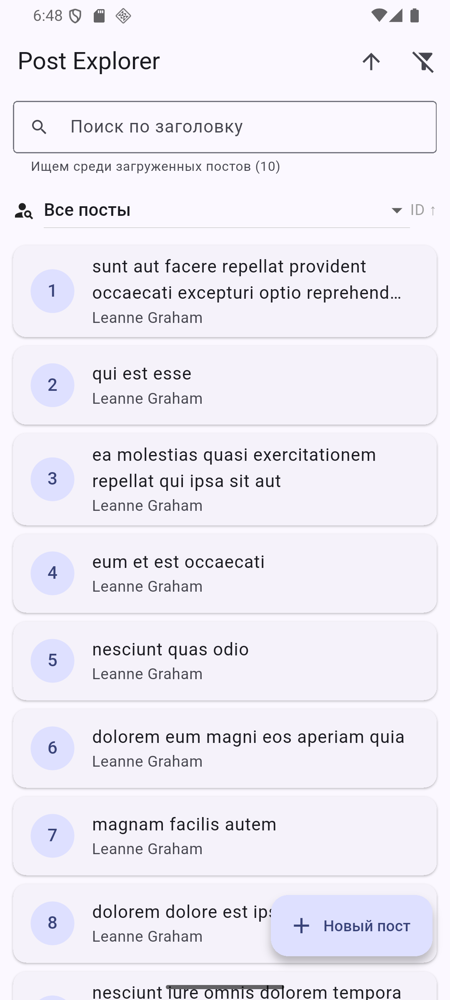
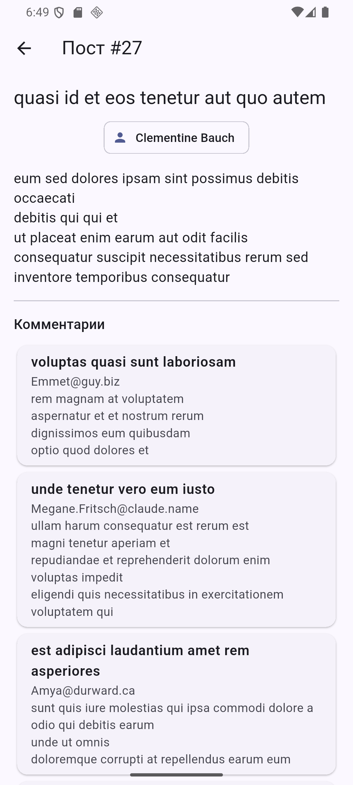
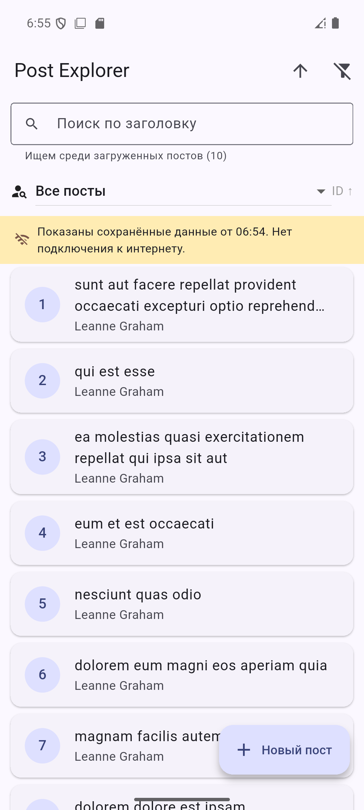

# СРС 8. Post Explorer

Flutter-приложение для просмотра, поиска и создания постов. API: [JSONPlaceholder](https://jsonplaceholder.typicode.com).
Dio + Retrofit, json_serializable, Repository, пагинация, кэш, обработка ошибок, тесты.

Выполнила: Ильяс Амина

## Запуск

```bash
flutter pub get
dart run build_runner build --delete-conflicting-outputs
flutter run
```

Тесты:

```bash
flutter test
```

## Архитектура

```
Presentation   screens/ · widgets/ · state/ (Cubit из flutter_bloc)
      │  UI знает только Repository, к Dio напрямую не обращается
Repository     post_repository.dart — кэш, преобразование ошибок в AppException
      │
Remote / Local post_api.dart (Retrofit) · dio_client.dart · api_interceptor.dart
               post_cache.dart (SharedPreferences)
      │
JSONPlaceholder REST API
```

```
lib/
├── core/
│   ├── network/   dio_client.dart, api_interceptor.dart
│   └── error/     app_exception.dart
├── data/
│   ├── models/    post, comment, user (+Address, Geo, Company), create_post_request
│   ├── remote/    post_api.dart (Retrofit)
│   ├── local/     post_cache.dart
│   └── repositories/ post_repository.dart
├── presentation/
│   ├── screens/   posts, post_details, author, create_post
│   ├── widgets/   post_tile, state_views
│   └── state/     posts_cubit, posts_state, create_post_cubit
└── main.dart
```

| Слой | Зачем |
|---|---|
| **Dio** | HTTP-клиент: базовый URL, таймауты, interceptors. Один экземпляр на всё приложение |
| **Retrofit** | Описываем запросы аннотациями (`@GET`, `@POST`), код запросов генерируется |
| **json_serializable** | Генерирует `fromJson` / `toJson`, ручной парсинг не нужен |
| **Repository** | Решает, откуда брать данные (сервер / кэш), и превращает ошибки в понятные сообщения |

## Запросы (Retrofit)

| Метод | Endpoint | Где используется |
|---|---|---|
| GET | `/posts?_page=&_limit=&userId=&_sort=id&_order=` | Список с пагинацией, фильтром и сортировкой |
| GET | `/posts/{id}` | Детали поста |
| GET | `/posts?userId={id}` | Посты автора |
| GET | `/posts/{id}/comments` | Комментарии |
| POST | `/posts` | Создание поста |
| GET | `/users` | Список авторов (фильтр, форма) |
| GET | `/users/{id}` | Экран автора |

## Состояния UI

| Состояние | Когда |
|---|---|
| Loading | Первая загрузка без кэша; отдельно — подгрузка страницы (`isLoadingMore`); отдельно — отправка формы (`CreatePostStatus.sending`) |
| Success | Данные получены с сервера |
| Cached | Показан кэш: обновление ещё идёт или сервер недоступен (жёлтая плашка) |
| Error | Ошибка и показать нечего — экран с кнопкой «Повторить» |
| Empty | Постов нет или поиск ничего не нашёл |

## Кэш: как ведёт себя приложение

- **Первый запуск** — кэша нет, крутится индикатор, посты загружаются с сервера и сохраняются в кэш.
- **Повторное открытие** — сразу показываются сохранённые посты с плашкой «Показаны сохранённые данные. Обновляем…», параллельно идёт запрос. После ответа список и кэш обновляются.
- **Нет интернета** — кэш остаётся на экране, плашка сообщает «Нет подключения к интернету». Последний успешный результат не удаляется. Без кэша — экран ошибки с кнопкой «Повторить».
- **Pull-to-refresh** — потянуть список вниз, чтобы обновить вручную.

Для каждого фильтра (автор + сортировка) свой кэш. Авторы и созданные посты тоже кэшируются.

## Поиск и фильтры

- Поиск по заголовку — **среди загруженных постов**, это написано под полем поиска.
- Фильтр по автору и сортировка по ID — на сервере. При смене фильтра страницы сбрасываются, ответы старых запросов игнорируются (`_requestId`), поэтому результаты не смешиваются.
- Кнопка «Сбросить фильтры» в AppBar.

## Создание поста

Валидация: title 5–100 символов, body 10–1000, автор обязателен. Во время отправки кнопка заблокирована.
JSONPlaceholder отвечает объектом с `id: 101`, но **не сохраняет** его. Поэтому пост хранится в приложении с пометкой «создан локально».

## Ошибки

`AppException.from()` различает: нет соединения, таймаут, HTTP 4xx, HTTP 5xx, ошибка JSON, неизвестная ошибка.
Пользователь видит понятный текст, технические подробности пишутся в лог (`debugPrint`, `LogInterceptor`).

## Тесты

```
flutter test
00:02 +16: All tests passed!
```

| Файл | Что проверяет |
|---|---|
| `models_test.dart` | JSON → Post, Post → JSON, отсутствующее поле → ошибка parse, вложенные модели User |
| `post_repository_test.dart` | Загрузка через репозиторий, ошибка 500 (кэш сохраняется), 404, некорректный JSON, POST через mock-адаптер Dio, фильтрация по заголовку и автору |
| `posts_cubit_test.dart` | Защита от повторной загрузки страницы, сброс страниц при смене фильтра, офлайн с кэшем, ошибка следующей страницы, валидация формы |

Все HTTP-тесты используют `http_mock_adapter` — интернет не нужен.

## Скриншоты

| Список | Детали и комментарии | Офлайн (кэш) |
|---|---|---|
|  |  |  |
